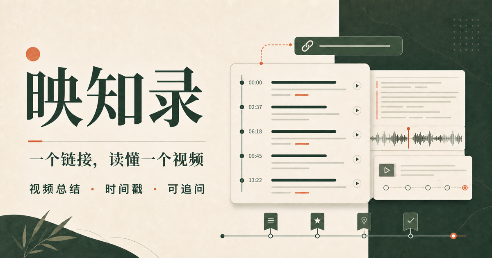
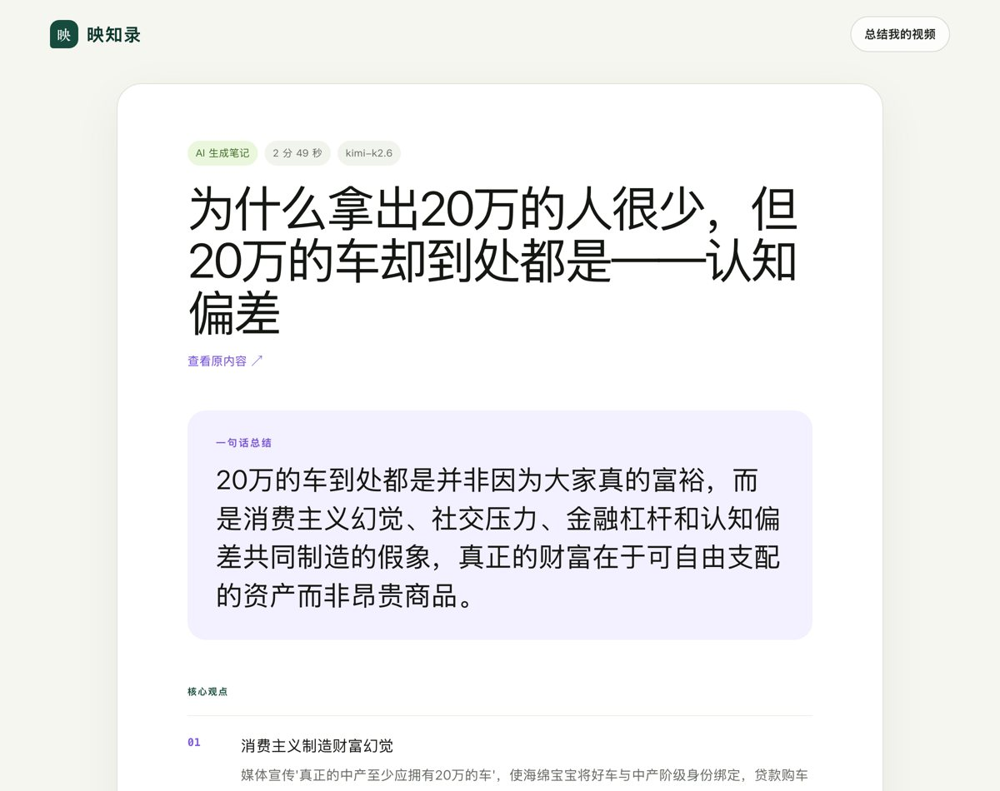

# 映知录 Yingzhilu

**一个链接，读懂一个视频。** 粘贴一个你有权处理的视频链接，映知录取得字幕（没有字幕时自动转写），生成章节、带时间戳的摘要，
并且只依据视频内容回答你的追问，每个回答都标出出处时间点。

One link in, one video understood: chapters, a timestamped summary and follow-up answers grounded in the video itself.

## 一份真实笔记

上图是一条 B站视频（约 3 分钟）的笔记：一句话结论、核心观点和带时间戳的章节，全部由 Kimi K2.6 依据视频原文生成。[打开这份笔记](https://yingzhilu.cn/s/cFQ9Ak69fOD1WyqDgdtKbxkPv-_fT7eC)，无需注册。

## 能做什么

- **视频链接、字幕文件、本地音视频**三种输入；无字幕时走语音识别，生成带时间戳的字幕。
- **章节与时间戳摘要**：每一条都带时间戳，对应视频里的位置。
- **可追溯问答**：回答只依据这段视频，并标出出处时间点。
- **导出**：Markdown、SRT、VTT 字幕和 Anki 卡片。
- **多模型路由**：默认 Kimi K2.6，智谱 GLM 与 DeepSeek 作为备用，服务端统一管理密钥。
- **成本与额度保护**：全站月度总结次数、语音识别分钟数和费用上限，超限自动熔断；上游失败有限重试，不占用户额度。
- **合规设计**：AIGC 显式标识、来源核验、版权投诉入口，只按平台白名单处理公开内容。
- **多端**：响应式网页与可安装 PWA，另有微信小程序、iOS（SwiftUI）和 Android（Jetpack Compose）客户端。

## 试用

直接打开 **<https://yingzhilu.cn>**，无需注册：粘贴一个 B站视频链接，点「检查素材」，确认后几十秒内得到带时间戳的章节、摘要，并可以继续追问。手机浏览器同样可用。

Open **<https://yingzhilu.cn>**, no sign-up needed: paste a Bilibili link, check it, confirm, and get timestamped chapters, a summary and follow-up answers within about a minute. Works on a phone.

## 关于本仓库

这是映知录的产品介绍页。产品的想法、设计与商业化由 Yi Yu 负责，开发主要由编程 Agent 完成。

© 2026 Yi Yu. All rights reserved. 源代码不公开。
